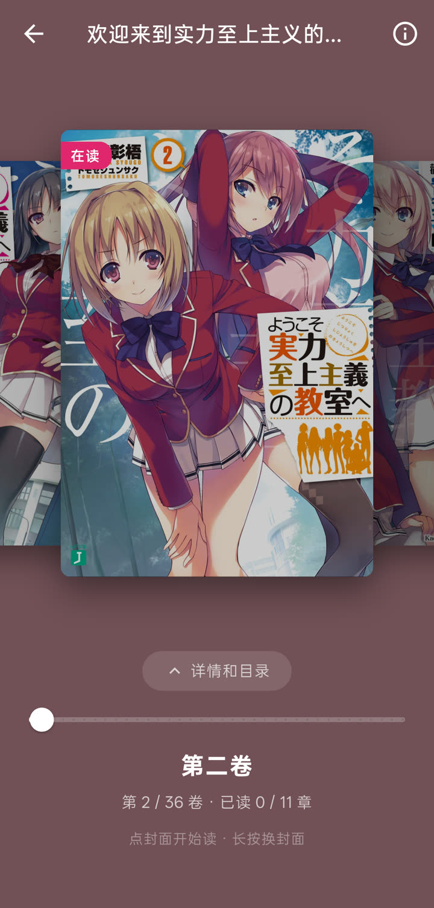

> [!WARNING]
> **编译出来就自己用，不要发到任何地方。** 这是原作者反复强调的要求：老版 Hikari Novel 就是因为安装包被到处传而关停的。本仓库同样不提供、也不会发布任何安装包。

# Hikari Novel

使用 Flutter 构建的第三方轻小说文库（wenku8）客户端

## 🙏 关于这个仓库

这是 [15dd/hikari_novel_flutter](https://github.com/15dd/hikari_novel_flutter) 的个人 fork。**Hikari Novel 由 [15dd](https://github.com/15dd) 创作**，界面设计、网站解析、项目名称和图标都来自原项目；也感谢原项目的其他贡献者（Hexplore、HExplorers-Smx、cyh128 等）。

在原项目的基础上，这里把 App 重写成了新框架（Riverpod + go_router），加了本地书架、离线阅读、朗读、同步等功能。原项目的网站请求和解析层（`lib/data/wenku8`）沿用至今。想用原版、或者想参与原项目的，请去原仓库。

## ✨ 功能

**书架**（参考 [Mihon](https://github.com/mihonapp/mihon)）
- 本地书架：数据都存在本机，打开就有，离线可看，没登录也能用
- 定期和网站书架双向同步：本地的加入、移出会推到网站，离线时先排队
- 本地分类：一本书可放进多个分类，可新建、改名、删除、拖动排序
- 筛选（有未读、有缓存、已完结）、6 种排序、网格 / 紧凑 / 列表三种显示，封面上一键继续阅读
- 检查更新：逐本检查新章节，"更新"页按日期分组

**阅读**
- 上下滚动、左右滑动、仿真翻页、覆盖翻页；宽屏双页；键盘翻页
- 字号、行距、页边距、字体（内置霞鹜文楷、思源宋体，也可以选自己的字体文件）、多种阅读背景、亮度遮罩
- 页眉页脚显示时间、电量和本章进度
- 朗读：句子高亮并自动翻页、定时停止、读完自动读下一章、手动翻页后从新位置接着读
- 正则规则：替换（去广告、统一用字）和高亮（人物名染色、备注）
- 书签、阅读历史、阅读统计和每本书的阅读报告（可存成图片分享）

**离线**
- 读过的章节自动缓存，并预取后面两章；可以缓存全本，或在目录里多选章节缓存
- 详情和目录先显示本地存的，再联网刷新；封面和插图存在本地

**其他**
- 坚果云 WebDAV 多设备同步（进度、书签、统计、规则），本地备份导入导出
- 发现页：推荐、排行、分类、完结；搜索（按书名 / 作者）；书评与回复
- 详情页：目录倒序、多选章节批量标记已读 / 未读
- Material Design 3，深浅色，多套配色（含角色主题）；手机、平板、电脑自适应
- 网络：可切换 wenku8.net / wenku8.cc 线路、HTTP 代理；默认用系统网络栈（安卓 Cronet、苹果 NSURLSession），被 Cloudflare 拦截时内置浏览器验证

## 📱 支持平台

| 平台 | 状态 |
|---|---|
| Android | 主要测试平台（release 包只含 arm64） |
| macOS | 可用，未签名 |
| iOS | 理论上支持，未测试 |
| Windows / Linux | 未测试 |
| Web | 不支持（仅开发时用 `tool/preview_proxy.dart` 预览界面） |

## 🖼️ 截图

> 下面是原项目的界面截图，新界面的截图还没补。

    

## 💻 编译

本项目不提供安装包，请自行编译、自己使用（见顶部警告）。

1. 安装 [Flutter](https://docs.flutter.dev/get-started/install)（开发用的是 stable 3.47）
2. 克隆本仓库，执行 `flutter pub get`
3. 编译：
   - Android：`flutter build apk --release --target-platform android-arm64 --dart-define=cronetHttpNoPlay=true`
     （`cronetHttpNoPlay` 让系统网络栈用内置的 Cronet，不依赖 Google 服务）
   - macOS：`flutter build macos --release`
4. 测试：`flutter test`

入口是 `lib/next/main.dart`（`lib/main.dart` 只是转过去）。

## 📣 声明

- 本项目是出于兴趣和学习移动端开发而做的，仅用于学习和测试
- 本项目所用接口均来自轻小说文库官方网站的公开页面，不提供任何破解内容
- 本项目是个人项目，与轻小说文库官方无关，请注意辨别

## 🧑‍💻 交流

原项目的 Telegram 群：
（这是原作者的群，这个 fork 的问题请在本仓库提 issue，不要去打扰原作者）

## 📖 参考

原项目参考了这些项目，这里一并致谢：

- [flutter_dmzj](https://github.com/xiaoyaocz/flutter_dmzj)
- [venera](https://github.com/venera-app/venera)
- [mihon](https://github.com/mihonapp/mihon)（本地书架、分类、筛选的设计也参考了它）
- [mikan_flutter](https://github.com/iota9star/mikan_flutter)
- [pilipala](https://github.com/guozhigq/pilipala)
- [PiliPalaX](https://github.com/orz12/PiliPalaX)
- [PiliPlus](https://github.com/bggRGjQaUbCoE/PiliPlus)

## 📄 许可证

[MIT](./LICENSE) © 2026 [15dd](https://github.com/15dd)。本 fork 的修改同样以 MIT 发布，原作者的版权声明保留不变。

## ⭐ 原项目星标趋势

